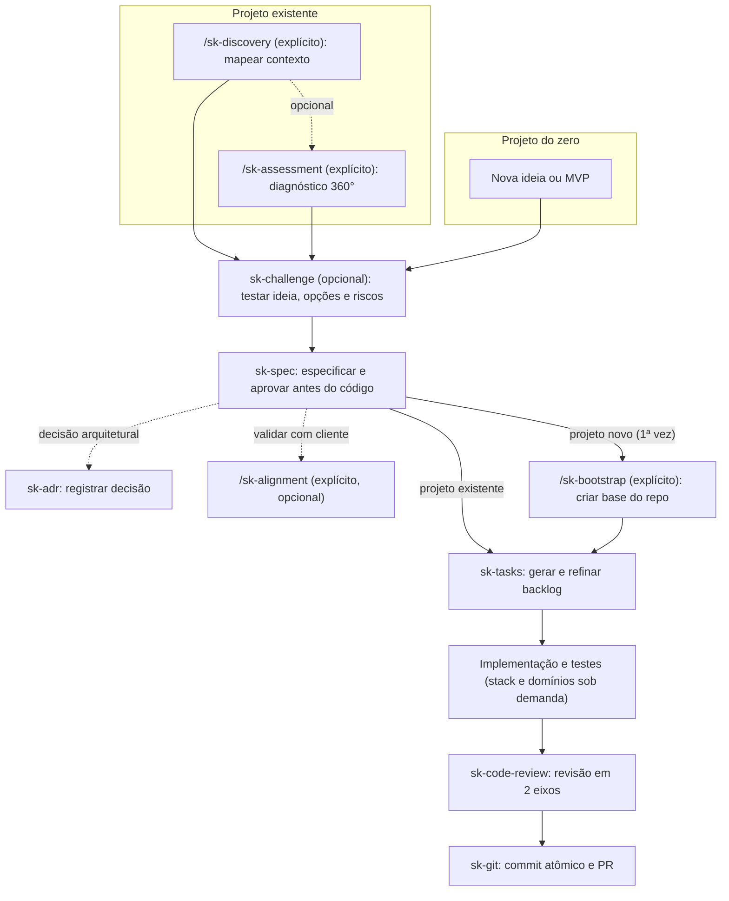

<div id="top" align="center">

   
   <h1>Agent Skills: Engineering Toolbox <a href="https://navto.me/heliomarpm" target="_blank"></a></h1>

   [](./skills/)
   [](./profiles.json)
   [](LICENSE)

   <div class="badges">

   [![GitHub Sponsors][url-github-sponsors-badge]][url-github-sponsors]
   [![PayPal][url-paypal-badge]][url-paypal]
   [![Ko-fi][url-kofi-badge]][url-kofi]
   [![Liberapay][url-liberapay-badge]][url-liberapay]
    
   </div>
</div>

---

Transforme assistentes de IA e IDEs agênticas em uma equipe de engenharia previsível: especificações aprovadas antes do código, decisões rastreadas, revisões em dois eixos e custo mínimo de tokens por turno.

Catálogo agnóstico de modelo e portável entre diferentes clientes compatíveis com Agent Skills (`SKILL.md`).

> **Navegação rápida:** [Por que usar](#por-que-usar) · [O que encontra aqui](#o-que-encontra) · [Início rápido](#inicio-rapido) · [Fluxo por cenário](#fluxo) · [Catálogo completo (39 skills)](#catalogo) · [Como funciona](#como-funciona)

---

<a id="por-que-usar"></a>
## 🎯 Por que usar estas skills?

Sem direcionamento, agentes de código tendem a pular requisitos, gerar código sem contexto, repetir erros em loop e gastar milhares de tokens por turno. Este catálogo impõe disciplina prática de engenharia:

| Assistente no improviso | Com esta Engineering Toolbox |
| :--- | :--- |
| Escreve código direto a partir de pedido ambíguo | **SDD com portão humano (`sk-spec`)**: especifica contratos, dados e critérios *Given/When/Then* e para para aprovação antes do código |
| Presume comandos, versões e números que não conferiu | **Evidência obrigatória**: lê manifestos reais e marca qualquer lacuna com `[A CONFIRMAR]` ou `(inferido)` |
| Fica preso corrigindo o mesmo erro de build/teste | **Circuit Breaker**: interrompe após **3 tentativas consecutivas** sobre a mesma falha e pede direção ao usuário |
| Carrega instruções enormes e concorrentes em todo turno | **Economia de tokens**: divulgação progressiva + perfis seletivos reduzem o custo fixo para `~771` a `~1.642` tokens/turno |
| Esquece índices, segurança, acessibilidade ou texto prolixo | **Rigor técnico nativo**: queries com índice obrigatório + rollback, revisão em 2 eixos, defesa contra *prompt injection*, WCAG 2.2 AA e escrita direta sem vícios |
| Depende de um fornecedor ou modelo específico | **Autocontida e validada em CI**: zero dependências externas obrigatórias, neutra de modelo e checada por [scripts/validate_skills.py](scripts/validate_skills.py) |

---

<a id="o-que-encontra"></a>
## 📦 O que você encontra aqui

- **39 skills `sk-*` divididas em 5 Pilares** ([profiles.json](profiles.json)): cobrem entrada em projeto legado, descoberta de produto/SDD, engenharia diária e upgrades, 8 domínios transversais e 15 stacks técnicas.
- **[Guia Prático SDD "For Dummies"](docs/GUIA_PRATICO_SDD.md)**: manual passo a passo mostrando o que o humano decide e o que a IA executa, do rascunho até a evolução de specs antigas.
- **[Guia de Autoria de Skills](docs/AUTHORING_SKILLS.md)**: contrato estrutural, teto de orçamento e checklist para propor novas skills `sk-*`.
- **Instaladores seletivos por Perfil ou Plugin** ([scripts/install.ps1](scripts/install.ps1) e [scripts/install.sh](scripts/install.sh)): instale apenas os Pilares e Stacks do seu projeto, sem poluir o catálogo do agente.
- **Camada 0 + utilitários locais sem dependências** ([rules/sk-core.md](rules/sk-core.md), `sk-design-system/templates/` e `sk-design-system/scripts/`): regras transversais compartilhadas e scripts Node.js puros para gerar e auditar tokens de design.
- **Governança automatizada em CI** ([.github/workflows/validate-skills.yml](.github/workflows/validate-skills.yml)): valida estrutura, teto de `360` caracteres nas descrições, links internos, neutralidade e finais de linha `LF`.

---

<a id="inicio-rapido"></a>
## 🚀 Início rápido (Instalação seletiva)

Em vez de vincular todas as 39 skills globalmente, instale **apenas o perfil do seu projeto**. Isso corta mais da metade do custo fixo por turno frente ao catálogo completo e evita sobreposição entre stacks que você não está usando.

### Windows (PowerShell)

Usa `Junction` (não exige PowerShell elevado nem Modo de Desenvolvedor). A flag `-Prune` remove links antigos `sk-*` fora do perfil sem tocar em nenhuma outra skill do seu diretório.

```powershell
# 1. Listar os 5 pilares, todos os perfis e o custo fixo estimado/turno
.\scripts\install.ps1 -List

# 2. Instalar o kit da sua stack (clientes: antigravity | claude | codex | agents | gemini)
.\scripts\install.ps1 -Profile backend-java -Client antigravity -Prune

# 3. Compor perfis customizados (com simulacao previa via -DryRun)
.\scripts\install.ps1 -Profile core,domains-backend,stack-node -Client claude -DryRun

# 4. Instalar como plugin completo (inclui Camada 0 em rules/AGENTS.md + plugin.json)
.\scripts\install.ps1 -Profile backend-java -Mode plugin -Client agents
```

### Linux e macOS

```bash
# 1. Listar os 5 pilares, perfis e custo fixo estimado/turno
./scripts/install.sh --list

# 2. Instalar perfil seletivo
./scripts/install.sh --profile backend-java --client antigravity --prune
./scripts/install.sh --profile core,domains-backend,stack-node --client claude

# 3. Instalar como plugin completo (Camada 0 + plugin.json + symlinks)
./scripts/install.sh --profile backend-java --mode plugin --client agents
```

### Perfis prontos e custo fixo estimado

| Perfil | O que inclui | Qtd. Skills | Custo fixo estimado |
| :--- | :--- | :---: | :---: |
| `core` | Pilares 1, 2 e 3 (Fundação + SDD + Engenharia Diária + Upgrades) | `16` *(9 impl.)* | **~771 tok/turno** |
| `mobile-flutter` | `core` + `domains-frontend` + `sk-tech-flutter` | `20` *(13 impl.)* | **~1.124 tok/turno** |
| `frontend-react` | `core` + `domains-frontend` + TS + React | `21` *(14 impl.)* | **~1.210 tok/turno** |
| `mobile-react-native` | `core` + `domains-frontend` + TS + React Native/Expo | `21` *(14 impl.)* | **~1.211 tok/turno** |
| `mobile-ionic` | `core` + `domains-frontend` + TS + Angular + Ionic/Capacitor | `22` *(15 impl.)* | **~1.308 tok/turno** |
| `backend-rust` | `core` + `domains-backend` + Rust | `23` *(16 impl.)* | **~1.381 tok/turno** |
| `backend-kotlin` | `core` + `domains-backend` + Kotlin JVM | `23` *(16 impl.)* | **~1.382 tok/turno** |
| `backend-java` | `core` + `domains-backend` + Java/Spring Boot | `23` *(16 impl.)* | **~1.382 tok/turno** |
| `backend-python` | `core` + `domains-backend` + `domains-ai` + Python | `24` *(17 impl.)* | **~1.466 tok/turno** |
| `fullstack-js` | `core` + backend + frontend + TS + Node + React | `26` *(19 impl.)* | **~1.642 tok/turno** |
| `all` | Todos os 5 Pilares completos (`39` skills `sk-*`) | `39` *(32 impl.)* | **~2.812 tok/turno** |

> Todos os perfis (`stack-*`, `domains-*`, `backend-dotnet`, `backend-go`, `backend-php`, `frontend-angular`, `frontend-vue`, `mobile-ionic-react`, `mobile-ionic-vue`, `mobile-android-kotlin`) podem ser combinados por vírgula e inspecionados com `-List` / `--list`.

<details>
<summary>Alternativa manual sem script (vincula todas as 39 sk-*)</summary>

**PowerShell (Windows):**
```powershell
$destino = "$HOME\.claude\skills" # ou \.gemini\config\skills, \.agents\skills, \.codex\skills
New-Item -ItemType Directory -Force $destino | Out-Null

Get-ChildItem .\skills -Directory -Filter "sk-*" | ForEach-Object {
  New-Item -ItemType Junction -Path (Join-Path $destino $_.Name) -Target $_.FullName
}
```

**Bash (Linux/macOS):**
```bash
destino="$HOME/.claude/skills" # ou .agents/skills, .gemini/config/skills, .codex/skills
mkdir -p "$destino"

for d in skills/sk-*/; do
  n=$(basename "$d")
  ln -sfn "$PWD/skills/$n" "$destino/$n"
done
```

</details>

---

<a id="fluxo"></a>
## 🔄 Fluxo direcionado por cenário



> **Atalhos fora do fluxo SDD:** correção de bugs pontuais (`sk-debug`), refatoração interna sem mudança de contrato (`sk-refactor`), upgrades de versão major (`/sk-upgrade`) e documentação pública (`/sk-readme` e `/sk-changelog`).

---

<a id="catalogo"></a>
## 📚 Catálogo completo (5 Pilares)

As **39 skills `sk-*`** ficam em pasta plana dentro de `skills/` para compatibilidade universal de links. **`🔒` indica ativação exclusivamente explícita (`disable-model-invocation: true`).**

### Pilar 1 · Fundação e Saúde

Skills estruturais para entrar em um projeto existente, auditar saúde ou inicializar um repositório novo. **100% explícitas (🔒)**.

| Skill | Foco | Quando usar? | Exemplo de uso (prompt) |
| :--- | :--- | :--- | :--- |
| `sk-discovery` 🔒 | Mapear um repositório e gerar os documentos de contexto (`CONTEXT.md`, `AGENTS.md` e outros, conforme o repositório) | Ao entrar num projeto novo ou legado, ou ao atualizar o contexto. Só por pedido explícito | "/sk-discovery Faça o discovery deste repositório e crie os arquivos de contexto para os assistentes de IA." |
| `sk-assessment` 🔒 | Diagnóstico crítico 360°, clean code, performance, eliminação de duplicidades e roadmap com evidências e sem bajulação | Ao auditar a saúde e excelência do projeto, enxugar duplicidades, planejar roadmap ou buscar melhorias estruturais. Só por pedido explícito | "/sk-assessment Faça um assessment crítico deste projeto: aponte fraquezas, quick wins, duplicidades e melhorias de performance." |
| `sk-bootstrap` 🔒 | Criar a base de um projeto novo em repositório vazio (estrutura, qualidade, CI e contexto), com plano aprovado | Ao iniciar um projeto do zero, depois de decidir a stack e o escopo. Só por pedido explícito; não para repositórios com código (`sk-discovery`) | "/sk-bootstrap Inicie o projeto conforme a spec do MVP e os ADRs: estrutura, testes, CI e documentos de contexto." |

### Pilar 2 · Descoberta, Decisão e SDD

Fluxo antes do código: tensionar ideias, registrar decisões arquiteturais, especificar, alinhar com o cliente e decompor tarefas.

| Skill | Foco | Quando usar? | Exemplo de uso (prompt) |
| :--- | :--- | :--- | :--- |
| `sk-challenge` | Questionar um plano, decisão ou ideia em rodadas, com recomendação própria | Antes de especificar ou decidir, para testar o raciocínio. Não para esclarecer um pedido simples (isso o `sk-spec` já faz) | "Me questione sobre este plano de migração antes de eu escrever a spec." |
| `sk-adr` | Registro formal de decisões técnicas e arquiteturais (ADR) | Decisão cara de reverter, que atravessa módulos ou que alguém vai questionar depois | "Registre a decisão de migrar para mensageria com um ADR e as alternativas descartadas." |
| `sk-spec` | Especificação testável e rastreável, aprovada antes do código | Feature nova ou mudança que altera comportamento, contrato ou dados. Não para bug simples ou ajuste trivial | "Crie a especificação da cobrança recorrente antes de iniciarmos o código." |
| `sk-alignment` 🔒 | Documento não técnico para confirmar spec/ADRs com o cliente, com revisão de clareza/tom e roteiro opcional de slides | Com a spec em rascunho, antes de construir, e para registrar as respostas do cliente. Só por pedido explícito | "/sk-alignment Gere o documento de alinhamento da spec 004 para o cliente confirmar." |
| `sk-tasks` | Backlog vivo em `TASKS.md` | Planejar, quebrar, refinar (prontidão para construir), atualizar ou auditar tarefas, e receber pendências das outras skills | "Verifique se as tarefas do backlog em TASKS.md estão prontas para iniciar ou precisam de refinamento." |

> 💡 Veja o passo a passo completo no **[Guia Prático SDD](docs/GUIA_PRATICO_SDD.md)**.

### Pilar 3 · Engenharia Diária e Entrega

Execução cotidiana de testes, depuração, refatoração, revisão, versionamento e documentação pública do repositório.

| Skill | Foco | Quando usar? | Exemplo de uso (prompt) |
| :--- | :--- | :--- | :--- |
| `sk-testing` | Estratégia e automação de testes | Escrever, auditar ou gerar testes a partir dos critérios da spec, e tratar testes instáveis | "Escreva os testes dos critérios de aceite da spec 003." |
| `sk-debug` | Causa raiz de bugs, correção mínima e teste de regressão | Erro, stack trace, comportamento inesperado, regressão ou falha só em produção ou CI | "Este endpoint retorna 500 de forma intermitente; ache a causa e corrija." |
| `sk-refactor` | Reestruturar sem mudar o comportamento | Código legado ou complexo, com rede de testes. Não para bug nem funcionalidade nova | "Refatore este módulo legado criando testes de caracterização antes de alterar a estrutura." |
| `sk-code-review` | Revisão em dois eixos: especificação e qualidade | Antes do merge de um PR ou diff, ou para auditar um módulo existente. Não para corrigir o código | "Faça o code review do diff em relação à main e aponte os débitos técnicos." |
| `sk-git` | Commits atômicos, PRs, histórico e conflitos | Ao commitar, abrir PR, atualizar branch, limpar histórico ou desfazer algo. Não para pipelines | "Prepare o commit e a PR desta mudança no padrão do projeto." |
| `sk-readme` 🔒 | README.md de um repositório, a partir de evidências, preservando o texto da equipe | Quando o README não existe ou está desatualizado. Só por pedido explícito | "/sk-readme Atualize o README deste repositório com a stack e os comandos atuais." |
| `sk-changelog` 🔒 | CHANGELOG.md no formato Keep a Changelog, a partir de commits e tags | Ao preparar uma release ou quando o CHANGELOG está desatualizado. Só por pedido explícito; não edita arquivo gerado por automação | "/sk-changelog Atualize o CHANGELOG com as mudanças desde a última tag." |
| `sk-upgrade` 🔒 | Upgrades de versão major, matriz EOL/*breaking changes*, saltos incrementais, codemods e rollback | Ao migrar framework/runtime major ou remediar CVE com quebra. Só por pedido explícito | "/sk-upgrade Planeje o upgrade de versão major deste projeto em saltos incrementais com plano de rollback." |

### Pilar 4 · Domínios Transversais

Guias especializados acionados conforme a natureza técnica da tarefa, com referências detalhadas carregadas sob demanda.

| Skill | Foco | Quando usar? | Exemplo de uso (prompt) |
| :--- | :--- | :--- | :--- |
| `sk-system-design` | Arquitetura de sistemas, mensageria, resiliência, cache e diagramas C4 | Projetar ou avaliar uma arquitetura, ou decidir se e como distribuir. Não para registrar a decisão (`sk-adr`) | "Projete uma arquitetura orientada a eventos com Outbox e consumidores idempotentes." |
| `sk-api-design` | Contratos OpenAPI 3.1, erros, idempotência, versionamento e webhooks | Criar, revisar ou evoluir contratos de API, ou checar se uma mudança quebra consumidores | "Modele o contrato da API de pagamentos com chave de idempotência e webhooks assinados." |
| `sk-sql` | Modelagem relacional, consultas performáticas, índices obrigatórios, transações, migrações seguras e NoSQL/Redis em apoio | Modelar banco, otimizar queries, criar índices/migrations ou modelar MongoDB/DynamoDB/Redis | "Otimize esta consulta no PostgreSQL e proponha o índice, ou defina a estratégia de TTL no Redis." |
| `sk-security` | Autenticação, autorização, OWASP, privacidade/LGPD e segredos | Auditar ou projetar proteção de dados, LGPD e acesso, ou tratar um segredo vazado | "Audite este fluxo de login e a conformidade LGPD nos logs, propondo correções por severidade." |
| `sk-observability` | OpenTelemetry, SLOs, alertas, probes, graceful shutdown, Web Vitals, testes de carga (k6) e post-mortem | Instrumentar, definir SLOs, planejar testes de carga/Web Vitals ou analisar incidentes | "Defina os SLOs da API de pagamentos, alertas por burn rate e o teste de carga em k6." |
| `sk-devops` | Contêineres, Kubernetes/Helm, CI/CD, OIDC, releases e Terraform | Dockerfile, Compose, Kubernetes/Helm, pipeline GitOps, deploy, release automática ou IaC | "Crie um Dockerfile multiestágio não root, o Deployment endurecido e o workflow com OIDC." |
| `sk-design-system` | Tokens em 3 camadas, WCAG 2.2 AA, Tailwind v4/shadcn, UI craft/mobile e scripts locais de geração e auditoria | Criar tokens (DTCG/CSS/`@theme`), projetar componentes, auditar contraste claro/escuro ou valores fixos | "Gere os tokens em Tailwind v4 e audite o contraste e a acessibilidade do modal." |
| `sk-ai-engineering` | Integração com LLMs: saídas estruturadas, ferramentas, RAG e avaliações | Integrar um LLM, criar agentes ou RAG, ou medir a qualidade das respostas | "Implemente um RAG com busca híbrida, filtro de permissões e um conjunto de avaliação." |

### Pilar 5 · Stacks (`sk-tech-*`)

Cada skill lê a versão do projeto no manifesto e aplica só o que ela suporta. Instale apenas as stacks usadas no seu dia a dia.

| Skill | Foco | Quando usar? | Exemplo de uso (prompt) |
| :--- | :--- | :--- | :--- |
| `sk-tech-typescript` | `tsconfig` estrito, sem `any`, validação de fronteira | Tipar código, remover `any`, configurar o `tsconfig` ou migrar para TypeScript | "Remova os `any` deste módulo e valide a entrada com um schema." |
| `sk-tech-nodejs` | ESM, validação, streams, SQL e shutdown (TS e JS puro) | Serviços, workers, rotas Next/Nuxt e ferramentas Node.js (TS ou JS) | "Implemente um worker de compressão com streams, cancelamento e caminho confinado." |
| `sk-tech-react` | Componentes tipados, estado de servidor, React 19 e SSR/RSC | Componentes, hooks, formulários, Next.js/Remix e dados em React | "Crie um formulário com `useActionState`, atualização otimista e Server Action validada." |
| `sk-tech-vue` | `script setup`, `defineModel`, composables, Pinia | Componentes, composables e estado em Vue 3 | "Implemente um composable de busca sem condição de corrida e um componente com `defineModel`." |
| `sk-tech-angular` | Signals, standalone, `OnPush`, `@defer` | Componentes, serviços de estado, rotas e formulários em Angular, ou migração para signals | "Crie um serviço de estado com signals e um componente de busca com `model` e `toSignal`." |
| `sk-tech-dotnet` | EF Core eficiente, async, Minimal APIs | APIs, serviços e acesso a dados em C# e .NET | "Construa um endpoint Minimal API com projeção no EF Core e `TypedResults`." |
| `sk-tech-java` | Spring Boot 3, Virtual Threads, JPA sem N+1 | APIs Spring Boot e persistência com JPA | "Desenvolva uma API Spring Boot com consultas JPA sem N+1 e projeção em record." |
| `sk-tech-golang` | `context`, `errgroup`, `net/http`, `slog` | Serviços HTTP, concorrência e ferramentas em Go | "Construa um serviço em Go com roteamento nativo, encerramento gracioso e `errgroup`." |
| `sk-tech-python` | Tipagem, Pydantic v2, `asyncio.TaskGroup` | Scripts, APIs e tarefas assíncronas em Python | "Crie uma rotina assíncrona com `TaskGroup`, tipagem moderna e validação com Pydantic." |
| `sk-tech-php` | `strict_types`, PDO seguro, PHP 8.4 | Aplicações web e APIs em PHP, puro ou com framework | "Modele um DTO em PHP 8.4 com property hook e um repositório PDO seguro." |
| `sk-tech-flutter` | Dart 3, Riverpod, camadas, renderização eficiente, a11y mobile | Telas, estado e navegação em aplicativos Flutter | "Estruture o estado desta tela com Riverpod `AsyncNotifier` e um repositório." |
| `sk-tech-ionic` | Ionic 7/8 + Capacitor, ciclo `ionView*`, Shadow DOM, nativo e SQLite | Apps híbridos Ionic (Angular/React/Vue) para iOS, Android e Web | "Implemente uma página standalone Ionic com `ionViewWillEnter` e cache SQLite indexado." |
| `sk-tech-react-native` | Expo / React Native, listas virtualizadas, `SecureStore`, a11y e SQLite | Aplicativos móveis em React Native ou Expo | "Crie uma listagem com `FlashList`, `useSafeAreaInsets` e armazenamento seguro de tokens." |
| `sk-tech-kotlin` | Kotlin JVM (Spring/Ktor), Android Compose, Coroutines/Flow e JPA/Exposed/Room | Serviços JVM ou aplicativos Android modernos em Kotlin | "Estruture um caso de uso com `coroutineScope`, `sealed interface` e consulta Exposed indexada." |
| `sk-tech-rust` | Ownership, `thiserror`/`anyhow`, `tokio`, `axum`/`actix` e `sqlx`/Diesel | Serviços HTTP, workers, bibliotecas e CLIs em Rust | "Implemente um handler `axum` sem `unwrap()`, com `sqlx` projetado, índice e shutdown." |

---

<a id="como-funciona"></a>
## ⚡ Como as skills funcionam

O repositório adota a **divulgação progressiva** (*progressive disclosure*): o assistente lê apenas os metadados (`description`) em todo turno e só abre o `SKILL.md` completo e os arquivos de apoio em `references/`, `templates/`, `examples/` ou `scripts/` quando a tarefa exige.

1. **Ativação contextual (implícita)**: 32 skills são acionadas quando o pedido traz indícios suficientes da tarefa. Cada `description` cabe no orçamento máximo de **360 caracteres** e traz escopo positivo + exclusões (`NÃO use para ...`) para evitar colisões.
2. **Ativação restrita (🔒 exclusivamente explícita)**: `sk-discovery`, `sk-assessment`, `sk-bootstrap`, `sk-alignment`, `sk-readme`, `sk-changelog` e `sk-upgrade` usam `disable-model-invocation: true` para evitar varreduras amplas, upgrades major ou edições públicas por inferência.
   - **Nota prática multi-cliente**: em assistentes que ocultam skills com `disable-model-invocation: true` do catálogo automático do modelo, invoque pelo comando `/sk-nome` ou citando explicitamente o nome da skill (por exemplo, `/sk-discovery` ou *"use a skill `sk-assessment` para auditar o projeto"*).
3. **Assinatura**: a **primeira mensagem do fluxo** começa com ``> 🧠 **Skill Ativada**: `sk-nome-da-skill` ``, para auditar que a skill certa foi ativada. As mensagens seguintes do mesmo fluxo não repetem a assinatura.

---

## 🏛️ Estrutura do repositório

```text
.
├── .github/workflows/
│   ├── semantic-release.yml
│   └── validate-skills.yml         # CI de estrutura, budget, links, neutralidade e EOL
├── docs/
│   ├── AUTHORING_SKILLS.md         # Guia de criacao de novas skills sk-*
│   ├── CODE_OF_CONDUCT.md
│   ├── CONTRIBUTING.md
│   ├── GUIA_PRATICO_SDD.md         # Guia pratico SDD ("For Dummies")
│   └── SUPPORT.md
├── profiles.json                   # Mapa dos 5 Pilares e perfis de instalacao
├── rules/
│   └── sk-core.md                  # Camada 0 (regras transversais para plugins)
├── scripts/
│   ├── install.ps1                 # Instalador seletivo Windows (link/plugin)
│   ├── install.sh                  # Instalador seletivo Linux/macOS (link/plugin)
│   └── validate_skills.py          # Validador automatizado do catalogo
└── skills/                         # 39 pastas sk-* (SKILL.md + apoios sob demanda)
```

Cada pasta em `skills/sk-*/` contém um `SKILL.md` e subpastas opcionais `references/`, `templates/`, `examples/` e `scripts/` lidas ou executadas apenas sob demanda (ex.: `sk-code-review/references/domain-checklists.md`, `sk-alignment/references/clear-writing-and-slides.md`, `sk-sql/references/nosql-and-redis.md`, `sk-security/references/lgpd-and-privacy.md`, `sk-tech-react/references/ssr-and-metaframeworks.md`, `sk-upgrade/references/upgrade-playbook.md`, `sk-devops/references/kubernetes.md`, `sk-observability/references/web-and-load-perf.md`, `sk-design-system/references/ui-craft-and-audit.md` e `sk-design-system/scripts/validate-tokens.cjs`).

---

## 🏗️ Padrão de construção de novas skills

Para propor uma nova skill dentro do padrão do catálogo, siga o [Guia de Autoria de Skills (AUTHORING_SKILLS.md)](docs/AUTHORING_SKILLS.md). Cada skill é uma pasta iniciada por `sk-` com um `SKILL.md` (e subpastas opcionais `references/`, `templates/`, `examples/` e `scripts/` para *progressive disclosure*):

```markdown
---
name: sk-nome-da-skill
description: "O que faz, gatilhos principais e 'NÃO use para ... (sk-...)' em até 360 caracteres."
allowed-tools: Read, Grep, Glob, Bash(comando específico *)
disable-model-invocation: true   # somente em skills de ativação explícita (com "ATIVAÇÃO EXPLÍCITA:" na description)
---

# Título

## 0. Regras de operação → (assinatura na primeira mensagem, escopo de escrita, evidência, circuit breaker quando aplicável, idioma)
## 1. Modos de operação
## 2. Workflow
...
## N. Integrações (e registro via `sk-tasks`)
## N+1. Armadilhas (sempre em bullet list)
## N+2. Padrão de entrega (sempre a última seção; item 1 = Assinatura)
```

Diretrizes:
- **Orçamento de `description`**: máximo de **360 caracteres**, concentrando intenção, 3 a 5 gatilhos e exclusões claras.
- **Ordem final obrigatória**: `Integrações` → `Armadilhas` (em lista, nunca tabela) → `Padrão de entrega` (última seção, iniciando pela Assinatura).
- **Progressive disclosure**: modelos, referências extensas e scripts utilitários locais (sem dependências externas) vão para `references/`, `templates/`, `examples/` ou `scripts/`, sempre linkados no `SKILL.md` (zero arquivos órfãos).
- **Autocontenção e neutralidade**: nenhuma skill referencia recursos fora do catálogo, caminhos fixos de cliente nem modelos proprietários específicos.
- **Circuit Breaker**: skills de execução/stack (`sk-tech-*`, `sk-debug`, `sk-refactor`, `sk-testing`, `sk-upgrade`, `sk-devops`, `sk-ai-engineering`) limitam tentativas consecutivas sobre a mesma falha e pausam para check-in.
- **Qualidade e validação**: mantenha [profiles.json](profiles.json) atualizado ao criar novas skills e rode `python scripts/validate_skills.py` antes de commitar.

### 🔒 Gestão de permissões (`allowed-tools`)

O campo `allowed-tools` **pré-aprova** apenas o que a skill usa no dia a dia, eliminando confirmações repetitivas. Ele não bloqueia as demais ferramentas: o que não está listado segue o fluxo normal de permissão do cliente e pede confirmação.

- **Pré-aprovado**: leitura, busca, edição de arquivos (nas skills que escrevem) e comandos específicos de teste, build, tipos e lint (por exemplo `npx vitest *`, `go test *`, `dotnet build *`). Não usamos curingas amplos como `npm run *`, `npx *` ou `python *`, que executam código arbitrário.
- **Pedem confirmação** (de propósito, fora do pré-aprovado): operações que alteram o mundo ou reescrevem histórico, como `git push`, `rebase`, `reset`, merge de PR, `terraform apply`, `kubectl apply`, `helm upgrade`, `docker push` e publicação de release.
- **Sem `Bash`**: skills conceituais (`sk-tasks`, `sk-api-design`, `sk-system-design`, `sk-sql`, `sk-observability`, `sk-design-system`). Algumas só leem o histórico do Git (`sk-adr`, `sk-spec`).
- **Modos somente leitura, por regra da skill**: `sk-code-review` só lê e registra pendências via `sk-tasks`, com confirmação; `sk-security` só edita no modo Corrigir, com aprovação. É uma instrução da skill, não um bloqueio técnico.
- **Ativação explícita**: `sk-discovery`, `sk-assessment`, `sk-bootstrap`, `sk-alignment`, `sk-readme`, `sk-changelog` e `sk-upgrade` usam `disable-model-invocation: true`.

> Para um bloqueio técnico real, use regras de `deny` nas configurações do cliente. O comportamento de `allowed-tools` e de `disable-model-invocation` pode variar entre clientes e versões: confirme no seu.

---

## 🙌 Padrão de commits (Conventional Commits)

Utilize mensagens semânticas ao commitar melhorias ou novas skills:

| Prefixo       | Exemplo                                                            |
| ------------- | ------------------------------------------------------------------ |
| `feat(skill)` | `feat(sk-tech-react): adiciona regras para React 19 Actions`         |
| `fix(skill)`  | `fix(sk-debug): corrige exemplo de detecção de causa raiz`           |
| `docs`        | `docs: atualiza o catálogo com exemplos de uso`                    |
| `refactor`    | `refactor(sk-observability): aprimora diretrizes de observabilidade` |

---

## 🤝 Contribuições e suporte

Existem várias formas de contribuir:

- ⭐ Marcar o repositório com uma estrela
- 🐞 Relatar bugs
- 💡 Sugerir funcionalidades ou novas stacks
- 🧾 Melhorar a documentação
- 📢 Compartilhar o projeto

Para propor uma skill ou melhoria, veja o [Guia de Contribuição](https://github.com/heliomarpm/skills/blob/main/docs/CONTRIBUTING.md).\
Se precisar de ajuda ou encontrou um problema, consulte o [Suporte](https://github.com/heliomarpm/skills/blob/main/docs/SUPPORT.md) ou abra uma [Issue](https://github.com/heliomarpm/skills/issues). Leia também o [Código de Conduta](https://github.com/heliomarpm/skills/blob/main/docs/CODE_OF_CONDUCT.md).

Obrigado a todos que já contribuíram:

[](https://github.com/heliomarpm/skills/graphs/contributors)

###### Criado com [contrib.rocks](https://contrib.rocks/image?repo=heliomarpm/skills-php)
---

## 💵 Apoie o Projeto

Se você gosta do projeto, considere fazer uma doação ao desenvolvedor via GitHub Sponsors, Ko-fi, PayPal ou Liberapay — a escolha é sua. 😉

[![GitHub Sponsors][url-github-sponsors-badge]][url-github-sponsors]
[![PayPal][url-paypal-badge]][url-paypal]
[![Ko-fi][url-kofi-badge]][url-kofi]
[![Liberapay][url-liberapay-badge]][url-liberapay]

---

## 📄 Licença

Distribuído sob a licença [MIT](https://github.com/heliomarpm/skills/blob/main/LICENSE) © [Heliomar P. Marques](https://github.com/heliomarpm).\
Sinta-se livre para utilizar, customizar e estender estas habilidades nos seus ambientes de desenvolvimento. [🔝](#top)


----
<!-- Sponsor badges -->

[url-github-sponsors]: https://github.com/sponsors/heliomarpm
[url-github-sponsors-badge]: https://img.shields.io/badge/GitHub%20-Sponsor-1C1E26?style=for-the-badge&labelColor=1C1E26&color=db61a2
[url-kofi]: https://ko-fi.com/heliomarpm
[url-kofi-badge]: https://img.shields.io/badge/kofi-1C1E26?style=for-the-badge&labelColor=1C1E26&color=ff5f5f
[url-liberapay]: https://liberapay.com/heliomarpm
[url-liberapay-badge]: https://img.shields.io/badge/liberapay-1C1E26?style=for-the-badge&labelColor=1C1E26&color=f6c915
[url-paypal]: https://bit.ly/paypal-sponsor-heliomarpm
[url-paypal-badge]: https://img.shields.io/badge/donate%20on-paypal-1C1E26?style=for-the-badge&labelColor=1C1E26&color=0475fe
