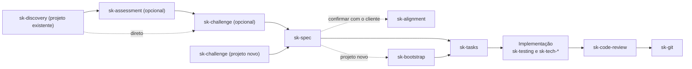

<div id="top" align="center">

   
   <h1> Agent Skills: Engineering Toolbox <a href="https://navto.me/heliomarpm" target="_blank"></a></h1>

   [](./skills/)
   [](https://github.com/)
   [](LICENSE)

   <div class="badges">

   [![GitHub Sponsors][url-github-sponsors-badge]][url-github-sponsors]
   [![PayPal][url-paypal-badge]][url-paypal]
   [![Ko-fi][url-kofi-badge]][url-kofi]
   [![Liberapay][url-liberapay-badge]][url-liberapay]
    
   </div>
</div>

---

Repositório central para versionamento, desenvolvimento e catalogação de **Habilidades de Agente (Agent Skills)** voltadas para engenharia de software com assistentes como **Google Antigravity**, **Gemini**, **Claude Code** e IDEs agênticas.

---

## 1. 📚 Catálogo de Habilidades e Exemplos de Uso

As skills ficam em `skills/`, cada uma em uma pasta iniciada por `sk-` (evita colisão de nomes e facilita a identificação visual). Elas se dividem em três grupos:

### 1.1. Fluxo de trabalho

Skills com etapas, pontos de aprovação e integração entre si. Ordem típica: `sk-discovery` (projeto existente), `sk-assessment` (avaliação e diagnóstico), `sk-challenge` (opcional), `sk-spec`, `sk-alignment` (confirmação com o cliente), `sk-bootstrap` (projeto novo), `sk-tasks`, implementação (com `sk-testing` e as `sk-tech-*`), `sk-code-review`, `sk-git`.

| Skill | Foco | Quando usar? | Exemplo de uso (prompt) |
| :--- | :--- | :--- | :--- |
| `sk-discovery` 🔒 | Mapear um repositório e gerar os documentos de contexto (`CONTEXT.md`, `AGENTS.md` e outros, conforme o repositório) | Ao entrar num projeto novo ou legado, ou ao atualizar o contexto. Só por pedido explícito | "Faça o discovery deste repositório e crie os arquivos de contexto para os assistentes de IA." |
| `sk-assessment` 🔒 | Diagnóstico crítico 360°, clean code, performance, eliminação de duplicidades e roadmap de excelência (curto a longo prazo) com evidências e sem bajulação | Ao auditar a saúde e excelência do projeto, enxugar duplicidades, planejar roadmap ou buscar melhorias estruturais. Só por pedido explícito | "Faça um assessment crítico deste projeto: aponte fraquezas, quick wins, duplicidades para mesclar e melhorias de performance." |
| `sk-challenge` | Questionar um plano, decisão ou ideia em rodadas, com recomendação própria | Antes de especificar ou decidir, para testar o raciocínio. Não para esclarecer um pedido simples (isso o `sk-spec` já faz) | "Me questione sobre este plano de migração antes de eu escrever a spec." |
| `sk-spec` | Especificação testável e rastreável, aprovada antes do código | Feature nova ou mudança que altera comportamento, contrato ou dados. Não para bug simples ou ajuste trivial | "Crie a especificação da cobrança recorrente antes de iniciarmos o código." |
| `sk-alignment` 🔒 | Documento em linguagem não técnica para confirmar o entendimento com o cliente, a partir da spec e dos ADRs | Com a spec em rascunho, antes de construir, e para registrar as respostas do cliente. Só por pedido explícito. Não para propostas comerciais | "Gere o documento de alinhamento da spec 004 para o cliente confirmar." |
| `sk-bootstrap` 🔒 | Criar a base de um projeto novo em repositório vazio (estrutura, qualidade, CI e contexto), com plano aprovado | Ao iniciar um projeto do zero, depois de decidir a stack e o escopo. Só por pedido explícito; não para repositórios com código (`sk-discovery`) | "Inicie o projeto conforme a spec do MVP e os ADRs: estrutura, testes, CI e documentos de contexto." |
| `sk-tasks` | Backlog vivo em `TASKS.md` | Planejar, quebrar, refinar (prontidão para construir), atualizar ou auditar tarefas, e receber as pendências das outras skills | "Verifique se as tarefas do backlog em TASKS.md estão prontas para iniciar ou precisam de refinamento." |
| `sk-code-review` | Revisão em dois eixos: especificação e qualidade | Antes do merge de um PR ou diff, ou para auditar um módulo existente. Não para corrigir o código | "Faça o code review do diff em relação à main e aponte os débitos técnicos." |
| `sk-refactor` | Reestruturar sem mudar o comportamento | Código legado ou complexo, com rede de testes. Não para bug nem funcionalidade nova | "Refatore este módulo legado criando testes de caracterização antes de alterar a estrutura." |
| `sk-testing` | Estratégia e automação de testes | Escrever, auditar ou gerar testes a partir dos critérios da spec, e tratar testes instáveis | "Escreva os testes dos critérios de aceite da spec 003." |
| `sk-git` | Commits atômicos, PRs, histórico e conflitos | Ao commitar, abrir PR, atualizar branch, limpar histórico ou desfazer algo. Não para pipelines | "Prepare o commit e a PR desta mudança no padrão do projeto." |
| `sk-debug` | Causa raiz de bugs, correção mínima e teste de regressão | Erro, stack trace, comportamento inesperado, regressão ou falha só em produção ou CI | "Este endpoint retorna 500 de forma intermitente; ache a causa e corrija." |
| `sk-readme` 🔒 | README.md de um repositório, a partir de evidências, preservando o texto da equipe | Quando o README não existe ou está desatualizado. Só por pedido explícito | "Atualize o README deste repositório com a stack e os comandos atuais." |
| `sk-changelog` 🔒 | CHANGELOG.md no formato Keep a Changelog, a partir de commits e tags | Ao preparar uma release ou quando o CHANGELOG está desatualizado. Só por pedido explícito; não edita arquivo gerado por automação | "Atualize o CHANGELOG com as mudanças desde a última tag." |


***🔒 indica ativação exclusivamente explícita.***
> 💡 **[Guia prático com exemplo de uso do `sk-spec` (SDD)](GUIA_PRATICO_SDD.md)**

### 1.2. Domínios e práticas

Guias consultados conforme o assunto da tarefa.

| Skill | Foco | Quando usar? | Exemplo de uso (prompt) |
| :--- | :--- | :--- | :--- |
| `sk-api-design` | Contratos OpenAPI 3.1, erros, idempotência, versionamento e webhooks | Criar, revisar ou evoluir contratos de API, ou checar se uma mudança quebra consumidores | "Modele o contrato da API de pagamentos com chave de idempotência e webhooks assinados." |
| `sk-adr` | Registro de decisões técnicas (ADR) | Decisão cara de reverter, que atravessa módulos ou que alguém vai questionar depois | "Registre a decisão de migrar para mensageria com um ADR e as alternativas descartadas." |
| `sk-system-design` | Arquitetura de sistemas, mensageria, resiliência, cache e diagramas C4 | Projetar ou avaliar uma arquitetura, ou decidir se e como distribuir. Não para registrar a decisão (`sk-adr`) | "Projete uma arquitetura orientada a eventos com Outbox e consumidores idempotentes." |
| `sk-sql` | Modelagem relacional, consultas, índices, transações e migrações | Modelar tabelas, otimizar consultas, criar índices, escrever migrações ou corrigir dados | "Otimize esta consulta lenta no PostgreSQL e proponha o índice, com o plano EXPLAIN." |
| `sk-security` | Autenticação, autorização, OWASP e segredos | Auditar ou projetar proteção de dados e acesso, ou tratar um segredo vazado | "Audite este fluxo de login e proponha as correções por severidade." |
| `sk-observability` | OpenTelemetry, SLOs, alertas, health checks e post-mortem | Instrumentar, definir SLOs e alertas, investigar desempenho em produção ou analisar um incidente | "Defina os SLOs da API de pagamentos e os alertas por burn rate." |
| `sk-devops` | Contêineres, CI/CD, OIDC, releases e Terraform | Dockerfile, Compose, pipeline, deploy, release automática ou infraestrutura como código | "Crie um Dockerfile multiestágio não root e um pipeline do GitHub Actions com OIDC." |
| `sk-design-system` | Tokens, acessibilidade WCAG 2.2 AA e API de componentes | Criar tokens, projetar componentes, auditar acessibilidade ou migrar valores fixos para tokens | "Modele os tokens semânticos com tema escuro e um botão acessível." |
| `sk-ai-engineering` | Integração com LLMs: saídas estruturadas, ferramentas, RAG e avaliações | Integrar um LLM, criar agentes ou RAG, ou medir a qualidade das respostas | "Implemente um RAG com busca híbrida, filtro de permissões e um conjunto de avaliação." |

### 1.3. Stacks (`sk-tech-*`)

Cada skill lê a versão do projeto no manifesto e aplica só o que ela suporta. Regras de tipagem em `sk-tech-typescript`.

| Skill | Foco | Quando usar? | Exemplo de uso (prompt) |
| :--- | :--- | :--- | :--- |
| `sk-tech-typescript` | `tsconfig` estrito, sem `any`, validação de fronteira | Tipar código, remover `any`, configurar o `tsconfig` ou migrar para TypeScript | "Remova os `any` deste módulo e valide a entrada com um schema." |
| `sk-tech-nodejs` | ESM, configuração validada, streams, encerramento gracioso | Serviços, workers, streams e ferramentas em Node.js | "Implemente um worker de compressão com streams, cancelamento e caminho confinado." |
| `sk-tech-react` | Componentes tipados, estado de servidor, React 19 | Componentes, hooks, formulários e dados em React | "Crie um formulário com `useActionState`, atualização otimista e TanStack Query." |
| `sk-tech-vue` | `script setup`, `defineModel`, composables, Pinia | Componentes, composables e estado em Vue 3 | "Implemente um composable de busca sem condição de corrida e um componente com `defineModel`." |
| `sk-tech-angular` | Signals, standalone, `OnPush`, `@defer` | Componentes, serviços de estado, rotas e formulários em Angular, ou migração para signals | "Crie um serviço de estado com signals e um componente de busca com `model` e `toSignal`." |
| `sk-tech-dotnet` | EF Core eficiente, async, Minimal APIs | APIs, serviços e acesso a dados em C# e .NET | "Construa um endpoint Minimal API com projeção no EF Core e `TypedResults`." |
| `sk-tech-java` | Spring Boot 3, Virtual Threads, JPA sem N+1 | APIs Spring Boot e persistência com JPA | "Desenvolva uma API Spring Boot com consultas JPA sem N+1 e projeção em record." |
| `sk-tech-golang` | `context`, `errgroup`, `net/http`, `slog` | Serviços HTTP, concorrência e ferramentas em Go | "Construa um serviço em Go com roteamento nativo, encerramento gracioso e `errgroup`." |
| `sk-tech-python` | Tipagem, Pydantic v2, `asyncio.TaskGroup` | Scripts, APIs e tarefas assíncronas em Python | "Crie uma rotina assíncrona com `TaskGroup`, tipagem moderna e validação com Pydantic." |
| `sk-tech-php` | `strict_types`, PDO seguro, PHP 8.4 | Aplicações web e APIs em PHP, puro ou com framework | "Modele um DTO em PHP 8.4 com property hook e um repositório PDO seguro." |
| `sk-tech-flutter` | Dart 3, Riverpod, camadas, renderização eficiente | Telas, estado e navegação em aplicativos Flutter | "Estruture o estado desta tela com Riverpod `AsyncNotifier` e um repositório." |

---

## 🔄 Fluxo típico



As demais skills entram conforme o assunto da tarefa: `sk-sql`, `sk-security`, `sk-api-design`, `sk-system-design`, `sk-debug`, `sk-refactor` e assim por diante.

---

## ⚡ Como as skills funcionam

O repositório adota a **divulgação progressiva** (*progressive disclosure*): o assistente lê a descrição de cada skill e só carrega o conteúdo completo quando a tarefa pede.

1. **Ativação contextual (implícita)**: a maioria das skills é acionada quando o pedido traz indícios suficientes da tarefa (uma refatoração, testes, uma consulta SQL, um componente React). O usuário não precisa citar o nome da skill. Cada `description` traz os gatilhos e também o que a skill **não** cobre, apontando para a skill certa.
2. **Ativação restrita (🔒 exclusivamente explícita)**: `sk-discovery`, `sk-assessment`, `sk-bootstrap`, `sk-alignment`, `sk-readme` e `sk-changelog` só rodam por pedido expresso (por exemplo, *"faça o discovery do projeto"*, *"avalie o projeto"*, *"atualize o README"*, *"prepare o changelog"*). Isso evita varreduras amplas e alterações de documentos públicos por inferência.
3. **Assinatura**: a **primeira mensagem do fluxo** começa com `> 🧠 **Skill Ativada**: sk-nome-da-skill`, para auditar que a skill certa foi ativada. As mensagens seguintes do mesmo fluxo não repetem a assinatura.

---

## 🏛️ Estrutura do repositório

```text
skills/
├── sk-adr/              ├── sk-security/
├── sk-ai-engineering/   ├── sk-spec/
├── sk-alignment/        ├── sk-sql/
├── sk-api-design/       ├── sk-system-design/
├── sk-assessment/       ├── sk-tasks/
├── sk-bootstrap/        ├── sk-tech-angular/
├── sk-challenge/        ├── sk-tech-dotnet/
├── sk-changelog/        ├── sk-tech-flutter/
├── sk-code-review/      ├── sk-tech-golang/
├── sk-debug/            ├── sk-tech-java/
├── sk-design-system/    ├── sk-tech-nodejs/
├── sk-devops/           ├── sk-tech-php/
├── sk-discovery/        ├── sk-tech-python/
├── sk-git/              ├── sk-tech-react/
├── sk-observability/    ├── sk-tech-typescript/
├── sk-readme/           ├── sk-tech-vue/
├── sk-refactor/         └── sk-testing/
```

Cada pasta contém um `SKILL.md`. Material de apoio extenso fica em `references/` dentro da skill e é lido só quando necessário (por exemplo, `sk-git/references/windows-utf8.md`).

---

## 🔗 Instalação e sincronização local

Vincule cada skill ao diretório de skills do seu cliente. O diretório varia: confirme na documentação do seu assistente. Exemplos comuns: Claude Code em `~/.claude/skills`, Antigravity/Gemini em `~/.gemini/config/skills` ou pasta comum para quase todos os agentes em `~/.agents/skills`.

Vincular **cada skill** (e não a pasta `skills/` inteira) evita um nível extra de aninhamento, que alguns clientes não varrem.

### Windows (PowerShell)

`Junction` não exige PowerShell elevado nem o Modo de Desenvolvedor.

```powershell
# Ajuste para o diretório de skills do seu cliente
$destino = "$HOME\.claude\skills" # ou \.agent\skills, \.gemini\skills, \.codex\skills, etc.
New-Item -ItemType Directory -Force $destino | Out-Null

Get-ChildItem .\skills -Directory | ForEach-Object {
  New-Item -ItemType Junction -Path (Join-Path $destino $_.Name) -Target $_.FullName
}
```

### Linux e macOS

```bash
# Ajuste para o diretório de skills do seu cliente
destino="$HOME/.claude/skills" # ou .agents/skills, .gemini/skills, .codex/skills, etc.
mkdir -p "$destino"

for d in skills/sk-*/; do
  n=$(basename "$d")
  ln -sfn "$PWD/skills/$n" "$destino/$n"
done
```

Os nomes das pastas seguem o prefixo `sk-`; use o nome completo ao criar links ou atalhos para uma skill.

---

## 🏗️ Padrão de construção de novas skills

Cada skill é uma pasta iniciada por `sk-` com um `SKILL.md`:

```markdown
---
name: sk-nome-da-skill
description: "O que faz, os gatilhos exatos e o 'NÃO use para ...' apontando a skill certa."
allowed-tools: Read, Grep, Glob, Bash(comando específico *)
disable-model-invocation: true   # somente em skills de ativação explícita
---

# Título

## 0. Regras de operação → (assinatura na primeira mensagem, escopo de escrita, evidência, idioma)
## 1. Modos de operação
## 2. Workflow
## 3. Exemplos e modelos
## 4. Integrações e registro via `sk-tasks`
## 5. Armadilhas
## 6. Padrão de entrega
```

Diretrizes: a `description` concentra os gatilhos e as exclusões; o conteúdo parte do projeto (lê o contexto e as versões do manifesto antes de agir); toda afirmação tem evidência; comandos só se rastreáveis a um manifesto ou workflow; a skill indica o que **não** faz e para onde encaminhar.

### 🔒 Gestão de permissões (`allowed-tools`)

O campo `allowed-tools` **pré-aprova** apenas o que a skill usa no dia a dia, eliminando confirmações repetitivas. Ele não bloqueia as demais ferramentas: o que não está listado segue o fluxo normal de permissão do cliente e pede confirmação.

- **Pré-aprovado**: leitura, busca, edição de arquivos (nas skills que escrevem) e comandos específicos de teste, build, tipos e lint (por exemplo `npx vitest *`, `go test *`, `dotnet build *`). Não usamos curingas amplos como `npm run *`, `npx *` ou `python *`, que executam código arbitrário.
- **Pedem confirmação** (de propósito, fora do pré-aprovado): operações que alteram o mundo ou reescrevem histórico, como `git push`, `rebase`, `reset`, merge de PR, `terraform apply`, `docker push` e publicação de release.
- **Sem `Bash`**: skills conceituais (`sk-tasks`, `sk-api-design`, `sk-system-design`, `sk-sql`, `sk-observability`, `sk-design-system`). Algumas só leem o histórico do Git (`sk-adr`, `sk-spec`).
- **Modos somente leitura, por regra da skill**: `sk-code-review` só lê e registra pendências via `sk-tasks`, com confirmação; `sk-security` só edita no modo Corrigir, com aprovação. É uma instrução da skill, não um bloqueio técnico.
- **Ativação explícita**: `sk-discovery`, `sk-assessment`, `sk-bootstrap`, `sk-alignment`, `sk-readme` e `sk-changelog` usam `disable-model-invocation: true`.

> Para um bloqueio técnico real, use regras de `deny` nas configurações do cliente. O comportamento de `allowed-tools` e de `disable-model-invocation` pode variar entre clientes e versões: confirme no seu.

---

## 🙌 Padrão de commits (Conventional Commits)

Utilize mensagens semânticas ao commitar melhorias ou novas skills:

| Prefixo       | Exemplo                                                            |
| ------------- | ------------------------------------------------------------------ |
| `feat(skill)` | `feat(sk-tech-react): adiciona regras para React 19 Actions`         |
| `fix(skill)`  | `fix(sk-debug): corrige exemplo de detecção de causa raiz`           |
| `docs`        | `docs: atualiza o catálogo com exemplos de uso`                    |
| `refactor`    | `refactor(sk-observability): aprimora diretrizes de observabilidade` |

---

## 🤝 Contribuições e suporte

Existem várias formas de contribuir:

- ⭐ Marcar o repositório com uma estrela
- 🐞 Relatar bugs
- 💡 Sugerir funcionalidades ou novas stacks
- 🧾 Melhorar a documentação
- 📢 Compartilhar o projeto

Para propor uma skill ou melhoria, veja o [Guia de Contribuição](https://github.com/heliomarpm/skills/blob/main/docs/CONTRIBUTING.md).\
Se precisar de ajuda ou encontrou um problema, consulte o [Suporte](https://github.com/heliomarpm/skills/blob/main/docs/SUPPORT.md) ou abra uma [Issue](https://github.com/heliomarpm/skills/issues). Leia também o [Código de Conduta](https://github.com/heliomarpm/skills/blob/main/docs/CODE_OF_CONDUCT.md).

Obrigado a todos que já contribuíram:

[](https://github.com/heliomarpm/skills/graphs/contributors)

###### Criado com [contrib.nn](https://contrib.nn.ci/?repo=heliomarpm/skills&no_bot=true)

---

## 💵 Apoie o Projeto

Se você gosta do projeto, considere fazer uma doação ao desenvolvedor via GitHub Sponsors, Ko-fi, PayPal ou Liberapay — a escolha é sua. 😉

[![GitHub Sponsors][url-github-sponsors-badge]][url-github-sponsors]
[![PayPal][url-paypal-badge]][url-paypal]
[![Ko-fi][url-kofi-badge]][url-kofi]
[![Liberapay][url-liberapay-badge]][url-liberapay]

---

## 📄 Licença

Distribuído sob a licença [MIT](https://github.com/heliomarpm/skills/blob/main/LICENSE) © [Heliomar P. Marques](https://github.com/heliomarpm).\
Sinta-se livre para utilizar, customizar e estender estas habilidades nos seus ambientes de desenvolvimento. [🔝](#top)


----
<!-- Sponsor badges -->

[url-github-sponsors]: https://github.com/sponsors/heliomarpm
[url-github-sponsors-badge]: https://img.shields.io/badge/GitHub%20-Sponsor-1C1E26?style=for-the-badge&labelColor=1C1E26&color=db61a2
[url-kofi]: https://ko-fi.com/heliomarpm
[url-kofi-badge]: https://img.shields.io/badge/kofi-1C1E26?style=for-the-badge&labelColor=1C1E26&color=ff5f5f
[url-liberapay]: https://liberapay.com/heliomarpm
[url-liberapay-badge]: https://img.shields.io/badge/liberapay-1C1E26?style=for-the-badge&labelColor=1C1E26&color=f6c915
[url-paypal]: https://bit.ly/paypal-sponsor-heliomarpm
[url-paypal-badge]: https://img.shields.io/badge/donate%20on-paypal-1C1E26?style=for-the-badge&labelColor=1C1E26&color=0475fe