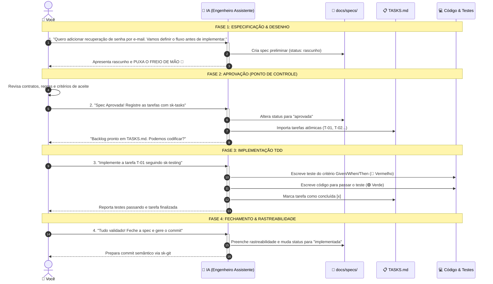

# 🧭 Guia Spec-Driven Development (SDD) "For Dummies"
> **O Manual Definitivo: O que o Humano faz (Manual) vs O que a IA faz (Automático)**

---

## 💡 A Analogia Básica (Para Nunca Mais Esquecer)

Imagine que desenvolver software com IA é igual a construir uma casa:

| Termo | O que é na prática? | Analogia da Construção |
| :--- | :--- | :--- |
| **`SPEC.md`** (`sk-spec`) | A especificação funcional | **A Planta Baixa do Arquiteto.** Sem ela aprovada com o dono, ninguém bate um tijolo. |
| **`TASKS.md`** (`sk-tasks`) | O backlog vivo de execução | **O Cronograma do Mestre de Obras.** Lista na prancheta o que fazer hoje, amanhã e o que já foi entregue. |
| **Código** (`sk-tech-*` + `sk-testing`) | Os arquivos `.ts`, `.py`, testes | **A Alvenaria e o Teste de Carga.** Subir a parede e conferir se não racha. |
| **`ADR`** (`sk-adr`) | Decisão arquitetural | **O Registro em Cartório.** Documenta por que escolheu fundação de concreto armado e não estacas de madeira. |

---

## 👥 Quem manda e quem faz?

* 👤 **Você (Humano):** Pensa, define o objetivo, revisa, aprova e decide se está pronto. **Você é o Diretor.**
* 🤖 **A IA:** Pesquisa código existente, formata requisitos, escreve cenários de teste (*Given/When/Then*), decompõe tarefas, codifica e roda testes. **Ela é o Braço Operacional.**

---

## 🟢 Ciclo 1: Criando uma Feature do Zero (Spec 001)

Imagine uma demanda comum de produto: permitir que uma pessoa **recupere o acesso à conta quando esquecer a senha**.

---

### Passo 1: Pedir a Especificação
* 👤 **VOCÊ FAZ (Manual):** Você dá o comando inicial proibindo código antecipado.
  > **Prompt:**  
  > *"Precisamos permitir que a pessoa recupere o acesso à conta quando esquecer a senha. Pensei em enviar um link por e-mail para ela criar uma nova senha. Analise o fluxo atual de autenticação e proponha os requisitos e critérios de aceite dessa mudança. Primeiro quero revisar a especificação; não implemente ainda."*

* 🤖 **A IA FAZ (Automático):**
  1. Ativa a skill com a assinatura: `> 🧠 **Skill Ativada**: sk-spec`.
  2. Cria o arquivo `docs/specs/001-recuperacao-de-senha.md` com `status: rascunho`.
  3. Escreve os requisitos (`RF-01`, `RF-02`), os cenários de teste Given/When/Then (`CA-01`, `CA-02`) e o plano preliminar (`T-01..T-04`).
  4. 🛑 **A IA PUXA O FREIO DE MÃO:** Ela **para obrigatoriamente** e pergunta: *"Posso aprovar e gerar as tarefas?"*.

---

### Passo 2: Revisar e Aprovar a Spec
* 👤 **VOCÊ FAZ (Manual):** Você lê o arquivo gerado. Se faltar algo, pede ajuste. Se estiver certo, dá a aprovação formal.
  > **Prompt:**  
  > *"Aprovado! Atualize o status da spec e importe as tarefas para o TASKS.md usando sk-tasks."*

* 🤖 **A IA FAZ (Automático):**
  1. Altera o frontmatter da spec para `status: aprovada`.
  2. Aciona `sk-tasks` no modo **Importar**.
  3. Registra as tarefas no `TASKS.md` com origem, prioridade e vínculo aos requisitos.

---

### Passo 3: Implementação Tarefa por Tarefa
* 👤 **VOCÊ FAZ (Manual):** Você autoriza o início da codificação.
  > **Prompt:**  
  > *"Inicie a implementação da T-001 e T-002 seguindo sk-tech-typescript e sk-testing."*

* 🤖 **A IA FAZ (Automático):**
  1. Cria o teste automatizado primeiro (TDD) refletindo o critério Given/When/Then.
  2. Executa o teste e confirma que falhou (vermelho).
  3. Escreve a implementação em TypeScript estrito.
  4. Executa o teste novamente e confirma que passou (verde).
  5. Vai no `TASKS.md` e marca a tarefa com `[x]`.

---

### Passo 4: Fechando a Spec
* 👤 **VOCÊ FAZ (Manual):** Após ver todas as tarefas concluídas, pede o fechamento.
  > **Prompt:**  
  > *"Todas as tarefas da Spec 001 foram concluídas com os testes passando. Finalize a spec e gere o commit."*

* 🤖 **A IA FAZ (Automático):**
  1. Abre `docs/specs/001-recuperacao-de-senha.md` e muda para `status: implementada`.
  2. Preenche a tabela de rastreabilidade (ligando cada critério `CA-NN` ao arquivo de teste real criado).
  3. Aciona a skill `sk-git` e prepara o commit semântico (ex: `feat(auth): implementar recuperação de senha por link`).

> 📌 **Resultado do Ciclo 1:** A `Spec 001` está no repositório com `status: implementada`. Ela **NÃO é deletada** nem arquivada; ela é agora a documentação viva e oficial do fluxo de recuperação de senha.

---

## 🟡 Ciclo 2: A Necessidade Mudou (Tornando a Spec 001 Obsoleta)

Durante a implementação, o produto decide que links de recuperação podem ser difíceis de usar em alguns dispositivos. A recuperação deve acontecer com um **código temporário enviado por e-mail**, em vez de um link.

> ❓ **Dúvida comum for dummies:**  
> *"Eu apago a Spec 001 do repositório?"*  
> 👉 **NÃO!** Documentação histórica é patrimônio do projeto. Você apenas declara que ela ficou **obsoleta** e aponta a substituta.

---

### Passo 1: Solicitar a Nova Spec com Vínculo Histórico
* 👤 **VOCÊ FAZ (Manual):** Você explica a nova demanda e avisa que ela substitui a antiga.
  > **Prompt:**  
  > *"Mudamos a recuperação de senha: em vez de enviar um link, queremos enviar um código temporário por e-mail para a pessoa criar uma nova senha. Revise o fluxo de autenticação e crie uma nova especificação que substitua a Spec 001, preservando o histórico."*

* 🤖 **A IA FAZ (Automático):**
  1. Cria `docs/specs/002-recuperacao-por-codigo.md` com `status: rascunho` e metadado `substitui: 001`.
  2. Na seção de Impacto no Legado, descreve a substituição do fluxo de link pelo fluxo de código temporário.
  3. 🛑 **Freio de mão:** Pede sua confirmação para tornar a 001 obsoleta e avançar.

---

### Passo 2: Aprovação Cruzada
* 👤 **VOCÊ FAZ (Manual):** Você autoriza a transição.
  > **Prompt:**  
  > *"Confirmado! Marque a Spec 001 como obsoleta, aprove a Spec 002 e atualize o TASKS.md."*

* 🤖 **A IA FAZ (Automático):**
  1. **Na Spec 001 (`docs/specs/001-recuperacao-de-senha.md`):**
     Muda para `status: obsoleta` e adiciona `substituida-por: 002` com data e motivo.
  2. **Na Spec 002 (`docs/specs/002-recuperacao-por-codigo.md`):**
     Muda para `status: aprovada`.
  3. **No `TASKS.md`:**  
     Adiciona as novas tarefas (incluindo a tarefa de remover o fluxo de link e invalidar tokens antigos com segurança).

---

### Passo 3: Implementação e Limpeza do Legado
* 👤 **VOCÊ FAZ (Manual):**
  > **Prompt:**  
  > *"Implemente as tarefas da Spec 002, substitua o fluxo antigo de link pelo código temporário e rode a suíte de testes."*

* 🤖 **A IA FAZ (Automático):**
  1. Remove o fluxo legado de recuperação por link, conforme previsto na Spec 002.
  2. Implementa a recuperação por código temporário com testes cobrindo os novos requisitos.
  3. Atualiza o `TASKS.md` com todas as tarefas concluídas.

---

### Passo 4: Fechando a Nova Spec
* 👤 **VOCÊ FAZ (Manual):**
  > **Prompt:**  
  > *"Tudo testado e aprovado. Feche a Spec 002 e prepare o commit."*

* 🤖 **A IA FAZ (Automático):**
  1. Muda a `Spec 002` para `status: implementada`.
  2. Preenche a rastreabilidade com os novos testes do fluxo de recuperação por código.
  3. Gera o commit semântico:  
     `feat(auth): ✨ substituir link por código na recuperação de senha`

---

## 📋 Resumo Visual "For Dummies": O que muda em cada arquivo?

| Arquivo | Antes do Ciclo 2 | Depois do Ciclo 2 |
| :--- | :--- | :--- |
| `docs/specs/001-recuperacao-de-senha.md` | `status: implementada` | `status: obsoleta` (com link para a 002) |
| `docs/specs/002-recuperacao-por-codigo.md` | *(Não existia)* | `status: implementada` (Fonte viva atual) |
| Fluxo de recuperação por link | Existia no código | **Substituído** pelo fluxo previsto na Spec 002 |
| Fluxo de recuperação por código | *(Não existia)* | **Criado** e coberto por testes |
| `TASKS.md` | Tarefas antigas arquivadas | Novas tarefas executadas e concluídas |

---

## 🛑 Os 3 Mandamentos para o Desenvolvedor

1. **Nunca deixe a IA pular direto para o código:**  
   Se ela tentar criar classes ou funções antes de você aprovar a spec, corte imediatamente: *"Pare. Primeiro crie a especificação e espere minha aprovação"*.
2. **Spec antiga nunca vai para a lixeira:**  
   Não delete arquivos de spec. Mudar para `status: obsoleta` preserva a memória histórica de por que o sistema funcionava daquele jeito antes.
3. **Spec é O QUÊ / ADR é POR QUÊ:**  
   - Se você está definindo regras de negócio, telas, rotas e testes $\to$ **Use `sk-spec`**.
   - Se você está escolhendo entre MongoDB ou PostgreSQL, Kafka ou RabbitMQ $\to$ **Use `sk-adr`**.
