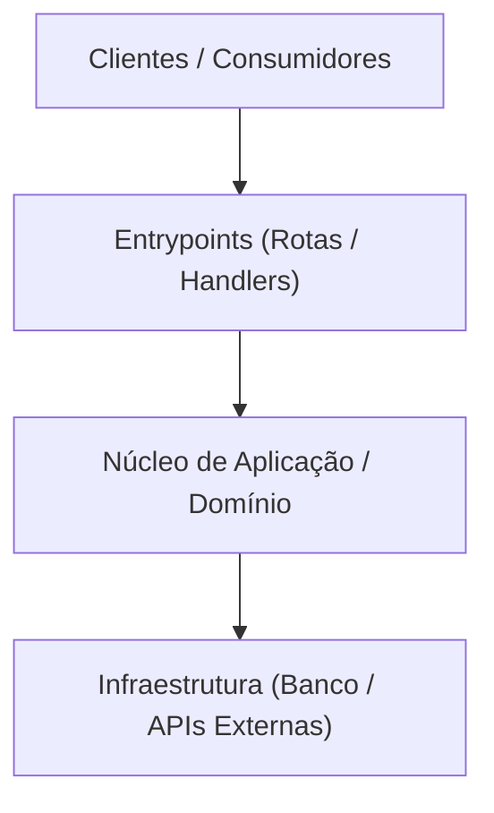

# Esqueleto dos Artefatos Condicionais do -discovery

> **Regras:**
> - Use apenas os arquivos aprovados no plano de entrega.
> - Preencha apenas seções que o repositório sustenta (evidências reais). O que for inferido recebe `(inferido)`; incertezas recebem `[A CONFIRMAR]`.
> - Sem emojis nos arquivos gerados. Links sempre relativos.
> - A seção `## Notas da Equipe` é preservada para anotações manuais; a skill nunca deve alterá-la em atualizações.

---

## 1. ARCHITECTURE.md (Limite: ~200 linhas)

# Arquitetura do Sistema: <Nome do Projeto>

> Atualizado em: <YYYY-MM-DD>

## Estilo Arquitetural
- Estilo: <Monolito Modular | Clean Architecture | Hexagonal | Microsserviços | MVC>
- Justificativa observada: <evidência no código e organização de pastas>

## Diagrama de Componentes

## Fluxo Principal de Execução
1. <Passo 1: entrada da requisição/evento e validação de schema>
2. <Passo 2: orquestração pelo caso de uso>
3. <Passo 3: regras de domínio e persistência>
4. <Passo 4: saída ou disparo de evento>

## Módulos e Responsabilidades

| Módulo | Responsabilidade | Dependências Diretas |
| :--- | :--- | :--- |
| `<pasta/módulo>` | `<papel no sistema>` | `<outros módulos>` |

## Pontos de Extensão
- <Onde e como adicionar novas funcionalidades, regras ou adaptadores>

## Riscos Arquiteturais Observados
- <Pontos de atenção, acoplamento excessivo ou dependências frágeis>

## Notas da Equipe
*(Espaço reservado para anotações manuais da equipe. A skill não altera esta seção.)*

---

## 2. DATA.md (Limite: ~150 linhas)

# Modelo de Dados e Integrações: <Nome do Projeto>

> Atualizado em: <YYYY-MM-DD>

## Banco de Dados e Migrações
- Banco principal: <tecnologia e versão> (Origem: <arquivo>)
- ORM / Ferramenta de Migração: <ferramenta> (Origem: <arquivo>)
- Comando de migração: `<comando>` (Origem: <arquivo>)

## Entidades Centrais

| Entidade | Papel | Relacionamentos Principais | Tabela / Coleção |
| :--- | :--- | :--- | :--- |
| `<Entidade>` | `<papel no negócio>` | `<1:N, N:N com outras entidades>` | `<tabela>` |

## Mensageria e Cache
- Mensageria: <tecnologia, filas ou tópicos observados>
- Cache: <tecnologia, casos de uso e TTL>

## Integrações Externas

| Sistema Externo | Finalidade | Arquivo de Integração | Autenticação |
| :--- | :--- | :--- | :--- |
| `<Serviço/API>` | `<finalidade>` | `<caminho do arquivo>` | `<Bearer / API Key / mTLS>` |

## Notas da Equipe
*(Espaço reservado para anotações manuais da equipe. A skill não altera esta seção.)*

---

## 3. PRD.md (Limite: ~150 linhas)

# PRD Retroativo: <Nome do Projeto>

> Atualizado em: <YYYY-MM-DD>

## Problema e Proposta de Valor
- Problema atendido: <dor ou necessidade que o sistema resolve>
- Proposta de valor: <benefício principal entregue> (inferido)

## Personas e Usuários (inferido)
- `<Persona 1>`: <como e por que interage com o sistema>
- `<Persona 2>`: <como e por que interage com o sistema>

## Funcionalidades Mapeadas

| ID | Funcionalidade | Status | Origem |
| :--- | :--- | :--- | :--- |
| F-01 | `<Nome da funcionalidade>` | `<Implementada \| Parcial \| Não verificada>` | `<rota, tela ou controller>` |

## Fora de Escopo Observado
- <Limitações explícitas ou recursos ausentes identificados no código>

## Métricas de Sucesso [A CONFIRMAR]
- <Indicadores esperados para o produto>

## Perguntas Abertas
- [A CONFIRMAR] <Dúvidas de regras de negócio identificadas>

## Notas da Equipe
*(Espaço reservado para anotações manuais da equipe. A skill não altera esta seção.)*

---

## 4. GUIDELINE.md (Limite: ~120 linhas)

# Diretrizes e Convenções de Engenharia

> Atualizado em: <YYYY-MM-DD>

## Nomenclatura e Organização
- Padrão de nomes de arquivos: `<kebab-case / camelCase>` (Origem: <arquivo/pasta>)
- Padrão de classes, funções e constantes: `<PascalCase / camelCase / UPPER_CASE>`
- Organização interna dos módulos: <regras observadas>

## Estrutura de Código
- Camadas e fronteiras: <regras de importação e isolamento>
- Validação de entrada: <onde e como ocorre>

## Tratamento de Erros e Logs
- Formato de erro exposto: <RFC 9457 Problem Details ou padrão customizado>
- Biblioteca e formato de logs: <JSON estruturado, biblioteca utilizada>

## Git e Versionamento
- Padrão de commits: <Conventional Commits ou convenção identificada no histórico>
- Padrão de branches: `<feature/*, fix/*>`

## Linters e Formatação
- Linter: <ferramentas e configurações estritas identificadas>
- Formatador: <Prettier, EditorConfig, etc.>

## Política de Dependências
- Regras para adição de novos pacotes e bibliotecas ao projeto.

## Notas da Equipe
*(Espaço reservado para anotações manuais da equipe. A skill não altera esta seção.)*

---

## 5. TESTING.md (Limite: ~80 linhas)

# Estratégia e Convenções de Testes

> Atualizado em: <YYYY-MM-DD>

## Frameworks e Execução

| Tipo | Framework | Comando | Origem |
| :--- | :--- | :--- | :--- |
| Unitários | `<framework>` | `<comando>` | `<package.json, Makefile, etc.>` |
| Integração | `<framework>` | `<comando>` | `<origem>` |
| Cobertura | `<ferramenta>` | `<comando>` | `<origem>` |

## Estrutura e Convenções
- Localização dos arquivos de teste: `<co-localizados ou pasta tests/>`
- Padrão de nomenclatura: `<*.spec.* ou *.test.*>`
- Estratégia de dublês de teste: `<mocks, stubs ou in-memory>`

## Tipos de Teste e Cobertura
- Cobertura observada e áreas com testes automatizados ativos.

## Lacunas Identificadas
- Áreas críticas do sistema que ainda não possuem testes identificados.

## Notas da Equipe
*(Espaço reservado para anotações manuais da equipe. A skill não altera esta seção.)*

---

## 6. OPERATIONS.md (Limite: ~120 linhas)

# Operações, CI/CD e Infraestrutura

> Atualizado em: <YYYY-MM-DD>

## Ambientes e Configuração
- Variáveis mapeadas de `.env.example` (apenas nomes e finalidade, sem valores):
  - `VARIAVEL_1`: <descrição>
  - `VARIAVEL_2`: <descrição>

## Pipelines de CI/CD
- Workflows identificados:
  - `<arquivo de workflow>`: <gatilho e etapas executadas>

## Processo de Deploy e Execução
- Contêiner: <Dockerfile multiestágio, imagem base>
- Orquestração local: <docker-compose.yml ou similar>
- Health Check: <rota ou comando de verificação de integridade>

## Observabilidade e Monitoramento
- Métricas: <formato e endpoints expostos>
- Tracing: <ferramenta de rastreamento distribuído>
- Logs: <destino e agregação dos logs>

## Notas da Equipe
*(Espaço reservado para anotações manuais da equipe. A skill não altera esta seção.)*

---

## 7. DECISIONS.md (Sem limite fixo)

# Índice de Decisões Técnicas e Arquiteturais

> Atualizado em: <YYYY-MM-DD>

## Decisões Registradas

*(Se existir pasta de ADRs, mantenha o índice com links):*

| ID | Título | Status | Data | Origem |
| :--- | :--- | :--- | :--- | :--- |
| `[ADR-NNN](./caminho/ADR-NNN.md)` | `<Título>` | `<Aceito \| Substituído>` | `<Data>` | `<arquivo>` |

*(Sem pasta de ADRs, registre decisões observadas em entradas curtas):*

### D-NN: <Título da Decisão>
- **Contexto:** `<motivo observável no código ou histórico>`
- **Decisão:** `<o que foi adotado>`
- **Consequências:** `<impacto positivo e trade-offs>`
- **Origem:** `<histórico git ou (inferido)>`

## Notas da Equipe
*(Espaço reservado para anotações manuais da equipe. A skill não altera esta seção.)*

---

## 8. GLOSSARY.md (Limite: ~80 linhas)

# Glossário de Termos de Domínio

> Atualizado em: <YYYY-MM-DD>

## Termos do Domínio

| Termo | Definição no Contexto do Projeto | Onde Aparece no Código |
| :--- | :--- | :--- |
| `<Termo>` | `<significado no domínio de negócio>` | `<pasta ou arquivo onde é usado>` |

## Notas da Equipe
*(Espaço reservado para anotações manuais da equipe. A skill não altera esta seção.)*
