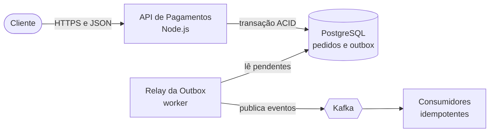

# System Design: arquitetura com trade-offs explícitos

Ajuda a projetar, evoluir e avaliar arquiteturas. A premissa é que distribuir tem custo: só se distribui com motivo concreto, e toda escolha declara o que se paga por ela.

## 0. Regras de operação

**Assinatura.** A primeira mensagem do fluxo começa com:

> 🧠 **Skill Ativa**: `-system-design`

As mensagens seguintes do mesmo fluxo não repetem a assinatura.

**A decisão é do usuário.** Apresente 2 ou 3 opções com trade-offs, recomende uma com justificativa e deixe a escolha para quem decide. Para decisão significativa, proponha registrá-la com o `-adr`.

**Comece simples.** Antes de propor serviços separados, avalie o monólito modular. Distribua só com motivo concreto (seção 4).

**Evidência e estimativas.** Números de capacidade (RPS, volume, latência) vêm do usuário, de documentação ou levam a marca `(estimativa)`. Nunca invente métricas.

**Onde escrever.** Por padrão, responda no chat. Salve em arquivo só a pedido, em `docs/design/<tema>.md`. Não altere o `ARCHITECTURE.md` do `-discovery` sem pedido e nunca altere código.

**Idioma.** O do usuário; nomes técnicos ficam como estão.

---

## 1. Modos de operação

| Modo | Quando |
| :--- | :--- |
| **Projetar** | Sistema ou módulo novo |
| **Evoluir** | Sistema existente: parte de `ARCHITECTURE.md`, ADRs e código |
| **Avaliar** | Revisar uma arquitetura contra o checklist (seção 8) |
| **Diagramar** | Apenas os diagramas C4 e de sequência (seção 9) |

---

## 2. Workflow

1. **Contexto**: leia `AGENTS.md`, `GUIDELINE.md`, `ARCHITECTURE.md`, `DATA.md` e os ADRs aceitos. Parta do que o projeto já tem (stack, broker, banco, infraestrutura).
2. **Requisitos** (seção 3): pergunte no máximo 3 coisas e assuma o resto, declarando as premissas.
3. **Comece simples** e decida se há motivo para distribuir (seção 4).
4. **Opções**: 2 ou 3 alternativas com prós, contras e o que cada uma exige da equipe.
5. **Modos de falha**: para cada integração, o que acontece se ela cair (seção 8).
6. **Recomendação** e diagrama (seção 9).
7. **Fechamento**: proponha o ADR da decisão (`-adr`), o detalhamento por feature (`-spec`) e o registro de tarefas (seção 10).

---

## 3. Requisitos antes do desenho

| Dimensão | O que levantar |
| :--- | :--- |
| Funcional | O que o sistema faz e para quem |
| Volume | RPS, tamanho dos dados, taxa de crescimento |
| Disponibilidade e latência | SLO desejado e o que acontece quando falha |
| Consistência | O que pode ser eventual e o que exige forte (CAP e PACELC como lente, não dogma) |
| Restrições | Orçamento, prazo, tamanho e perfil da equipe, stack existente, conformidade |

Faça estimativas de capacidade de ordem de grandeza e marque como `(estimativa)`.

---

## 4. Quando distribuir

Serviços separados se justificam com: **escala independente** de um componente, **equipes autônomas** com ciclos de release distintos, **isolamento de falha** ou requisitos de segurança e conformidade diferentes. Sem isso, prefira um monólito modular, com fronteiras claras que permitam extrair depois.

Cada ponto de distribuição custa consistência, latência e operação. O risco clássico é o **monólito distribuído**: serviços acoplados por banco compartilhado ou por cadeias de chamadas síncronas.

---

## 5. Catálogo de padrões e seus custos

| Padrão | Use quando | O que se paga |
| :--- | :--- | :--- |
| Transactional Outbox | Perder um evento é inaceitável e há banco relacional e broker | Worker extra, latência, duplicatas |
| Consumidor idempotente (inbox) | Todo consumidor com entrega at-least-once | Tabela e escrita extra |
| Saga (orquestrada ou coreografada) | Uma transação de negócio atravessa serviços | Compensações complexas, depuração difícil |
| CQRS | Leitura e escrita com perfis muito diferentes | Consistência eventual, dois modelos |
| Event sourcing | Auditoria e histórico temporal são requisito central | Complexidade alta; raro |
| Circuit breaker | Dependência instável | Estados e ajuste fino |
| Retry com backoff e jitter | Falhas transitórias | Amplifica carga se não houver limite |
| Timeout e bulkhead | Isolar falhas | Ajuste fino |
| Rate limiting e backpressure | Proteger recursos | Rejeição de requisições |
| Cache-aside | Leitura intensiva | Invalidação e dados desatualizados |
| BFF e API gateway | Clientes com necessidades distintas | Componente a mais |
| Strangler Fig | Migrar legado de forma incremental | Convivência longa (veja `-refactor`) |

Ao usar o Outbox: quando perder um evento é aceitável, ou quando o projeto usa CDC por log ou event store, ele pode não compensar.

---

## 6. Mensageria

**Escolha com critérios**, partindo do que o projeto já usa:

| Necessidade | Tende a | 
| :--- | :--- |
| Fila de trabalho, roteamento flexível | RabbitMQ, SQS |
| Log de eventos com retenção, replay e vários consumidores | Kafka, Kinesis |
| Pouca operação, serviço gerenciado | SQS e SNS ou equivalente do provedor |

**Semântica de entrega.** Não prometa "exactly-once". O correto é **at-least-once com consumidor idempotente**, que dá efeito exatamente uma vez. Defina também:

- **Ordenação**: por chave e partição; sem chave, não há ordem.
- **Retry**: backoff, limite de tentativas e tratamento de erro permanente.
- **DLQ**: com alerta e procedimento de reprocessamento, para não esconder o problema.
- **Poison message**: mensagem que falha sempre vai para a DLQ, sem travar a partição.
- **Contratos de eventos**: versionados e compatíveis (schema registry); o contrato assíncrono é do `-api-design`.

---

## 7. Exemplos de referência

### 7.1. Outbox com relay

```sql
CREATE TABLE outbox_events (
  id             uuid PRIMARY KEY,           -- gerado na aplicação
  aggregate_type text        NOT NULL,
  aggregate_id   text        NOT NULL,
  event_type     text        NOT NULL,
  payload        jsonb       NOT NULL,
  created_at     timestamptz NOT NULL DEFAULT now(),
  published_at   timestamptz,
  attempts       int         NOT NULL DEFAULT 0
);
CREATE INDEX outbox_pendentes_idx ON outbox_events (created_at) WHERE published_at IS NULL;

-- Produtor: regra de negócio e evento na MESMA transação
BEGIN;
INSERT INTO orders (id, customer_id, total, status) VALUES (:id, :cliente, :total, 'CREATED');
INSERT INTO outbox_events (id, aggregate_type, aggregate_id, event_type, payload)
VALUES (:evento_id, 'Order', :id, 'OrderCreated', :payload);
COMMIT;

-- Relay: lote em transação curta
SELECT id, aggregate_id, event_type, payload
FROM outbox_events
WHERE published_at IS NULL
ORDER BY created_at
LIMIT 100
FOR UPDATE SKIP LOCKED;
-- publica no broker, com aggregate_id como chave; depois:
UPDATE outbox_events SET published_at = now() WHERE id = ANY(:ids);
```

Notas: se o relay cair entre publicar e atualizar, o evento sai de novo (at-least-once), por isso os consumidores precisam ser idempotentes. Com vários relays, `SKIP LOCKED` pode alterar a ordem; se a ordem por agregado importa, particione os relays por hash de `aggregate_id` ou use um só. Limpe periodicamente os publicados antigos.

### 7.2. Consumidor idempotente (inbox)

```sql
-- Mesma transação do efeito no domínio
BEGIN;
INSERT INTO processed_events (event_id, processed_at)
VALUES (:event_id, now())
ON CONFLICT (event_id) DO NOTHING;
-- 0 linhas inseridas: evento duplicado. COMMIT e ignore.
-- 1 linha inserida: aplique o efeito no domínio (UPDATE ou INSERT).
COMMIT;
```

Notas: a deduplicação e o efeito precisam estar na mesma transação; gravar a chave antes e apagá-la no erro perde eventos se o processo cair no meio. Se o efeito é externo (e-mail, pagamento), use uma chave de idempotência no sistema externo. Redis com `SET NX` serve só para deduplicação *best-effort* de efeitos não críticos.

### 7.3. Cache sem tempestade (stampede)

```text
funcao obter(chave):
    valor = cache.get(chave)
    se valor existe e nao expirou: retorne valor
    retorne singleFlight(chave, () ->
        valor = origem.carregar(chave)
        cache.set(chave, valor, ttl = base + aleatorio(0, jitter))
        retorne valor)
```

`singleFlight` deixa uma única chamada regenerar a chave enquanto as demais aguardam. Alternativas: servir o valor antigo enquanto revalida, ou expiração antecipada probabilística. TTL é obrigatório, cache nunca é fonte de verdade, e a invalidação, o cache negativo e a taxa de acertos fazem parte do desenho.

---

## 8. Modos de falha e checklist

**Modos de falha**: para cada integração, preencha:

| Se cair... | Efeito | Mitigação |
| :--- | :--- | :--- |
| Broker | Eventos acumulam na Outbox | Alerta de atraso, retry do relay |
| Serviço de pagamento | Cobrança pendente | Timeout, circuit breaker, fila de reprocessamento |
| Cache | Carga vai para o banco | Limite de concorrência, degradação controlada |

Cadeias síncronas longas e retries sem limite causam falha em cascata e tempestades de tentativas; filas sem limite só escondem o problema.

**Checklist de revisão** (aponte a skill responsável quando existir):

- Consistência por fronteira: o que é forte e o que é eventual?
- Disponibilidade e escala: pontos únicos de falha, gargalos, particionamento.
- Segurança entre serviços: autenticação, autorização e segredos (`-security`).
- Isolamento entre clientes, em sistemas multitenant.
- Observabilidade: traces correlacionados, lag de consumidores, métricas e alertas (`-observability`).
- Dados: réplicas, backup, retenção (`-sql`).
- Implantação e custo (`-devops`).

---

## 9. Diagramas C4 em Mermaid

Use os níveis 1 (contexto), 2 (contêineres) e 3 (componentes), sem misturar níveis, com relações rotuladas com o protocolo e elementos coerentes com o texto. Para fluxos, use diagrama de sequência. A sintaxe `C4Container` do Mermaid é experimental e renderiza de forma irregular; prefira `flowchart` e informe qual usou.



---

## 10. Registro via `-tasks` e integrações

Se o desenho tem etapas de implementação, pergunte ao final:

> *"Deseja que eu decomponha a implementação em tarefas no `TASKS.md` do projeto?"*

Com a confirmação, acione a skill `-tasks` (modo Importar), com origem `system-design`, links relativos e a prioridade: infraestrutura base e contratos P1 (tabelas, tópicos, migrações com zero downtime); produtores, consumidores, DLQ e workers P2; cache, métricas e dashboards P3. **Fallback**: lista no chat.

| Skill | Como se integra |
| :--- | :--- |
| `-adr` | Registra a decisão escolhida |
| `-spec` | Detalha a feature que usa o desenho |
| `-api-design` | Contratos síncronos e assíncronos |
| `-sql` | Esquema, consultas e transações |
| `-security` | Segurança entre serviços |
| `-observability` | Métricas, traces e alertas |
| `-devops` | Infraestrutura e implantação |
| `-refactor` | Migrações incrementais (Strangler Fig) |
| `-testing` | Testes de integração com broker, idempotência e falhas |
| `-tech-*` | Idiomas e bibliotecas da stack |

Se alguma não existir, siga o padrão desta skill sem a integração.

---

## 11. Armadilhas

- **Microsserviços prematuros**: custo de distribuição sem benefício.
- **Banco compartilhado entre serviços**: acoplamento disfarçado.
- **Cadeia síncrona sem timeout**: falha em cascata.
- **Retry sem limite**: amplifica a falha.
- **Fila sem limite**: esconde o problema até estourar.
- **"Exactly-once" prometido**: entregue at-least-once com idempotência.
- **DLQ sem alerta**: mensagens perdidas sem ninguém saber.
- **Eventos sem versionamento**: quebra consumidores.
- **Cache como fonte de verdade**: dados inconsistentes sem origem para recuperar.
- **Dual-write**: gravar no banco e publicar sem Outbox quando perder o evento é inaceitável.
- **Diagrama com níveis misturados**: confunde em vez de explicar.

---

## 12. Padrão de entrega

1. Assinatura na primeira mensagem (seção 0) e o modo usado (seção 1).
2. Requisitos e premissas declarados, com as estimativas marcadas.
3. Opções com trade-offs, a recomendação e o motivo.
4. Diagrama (C4 ou sequência) e a tabela de modos de falha.
5. Garantia de entrega da mensageria, deduplicação e DLQ definidas.
6. Próximos passos: ADR, spec e a pergunta sobre o registro em tarefas (seção 10).